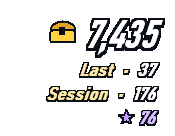
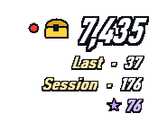
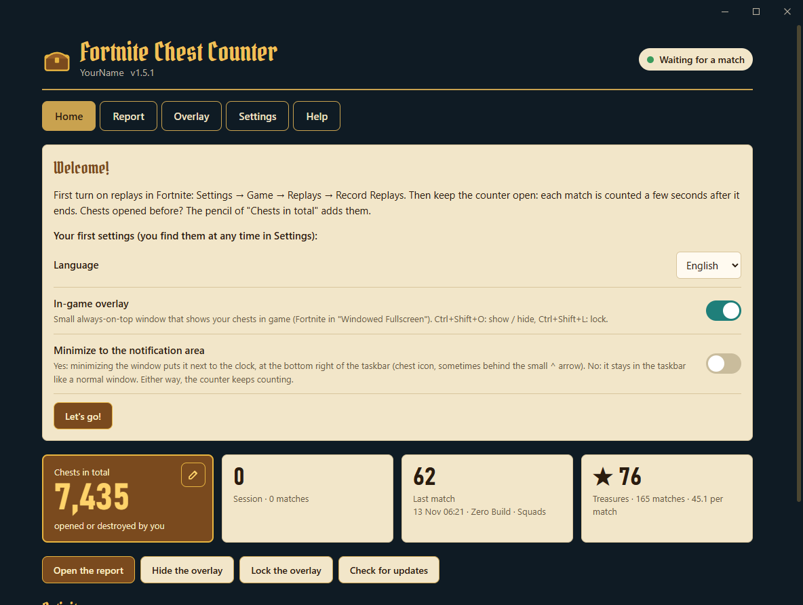
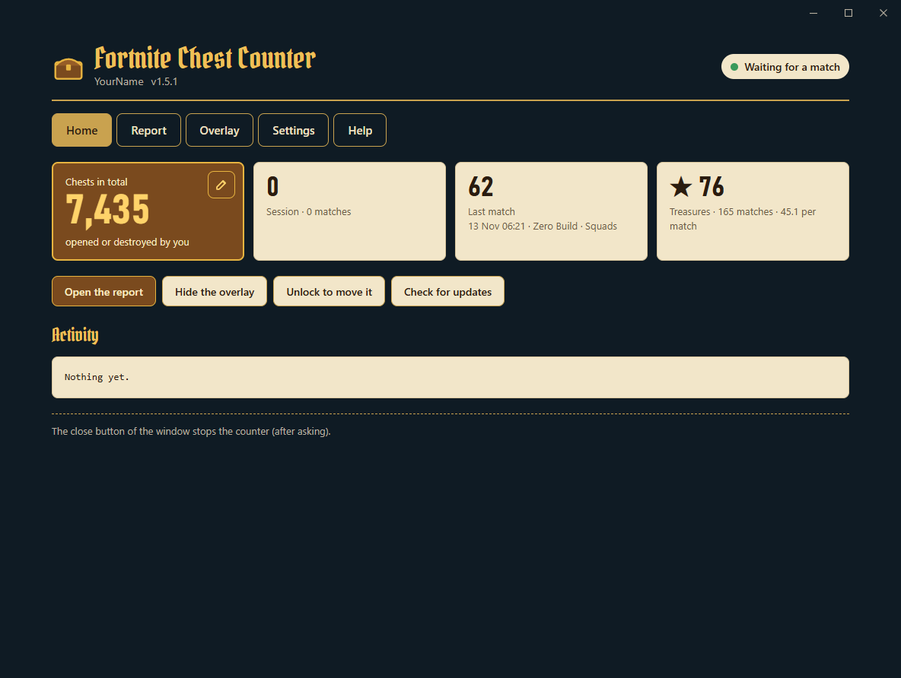
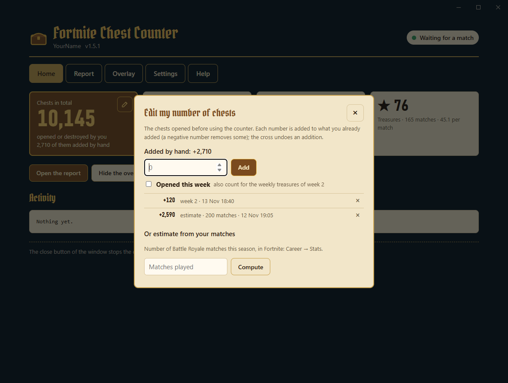
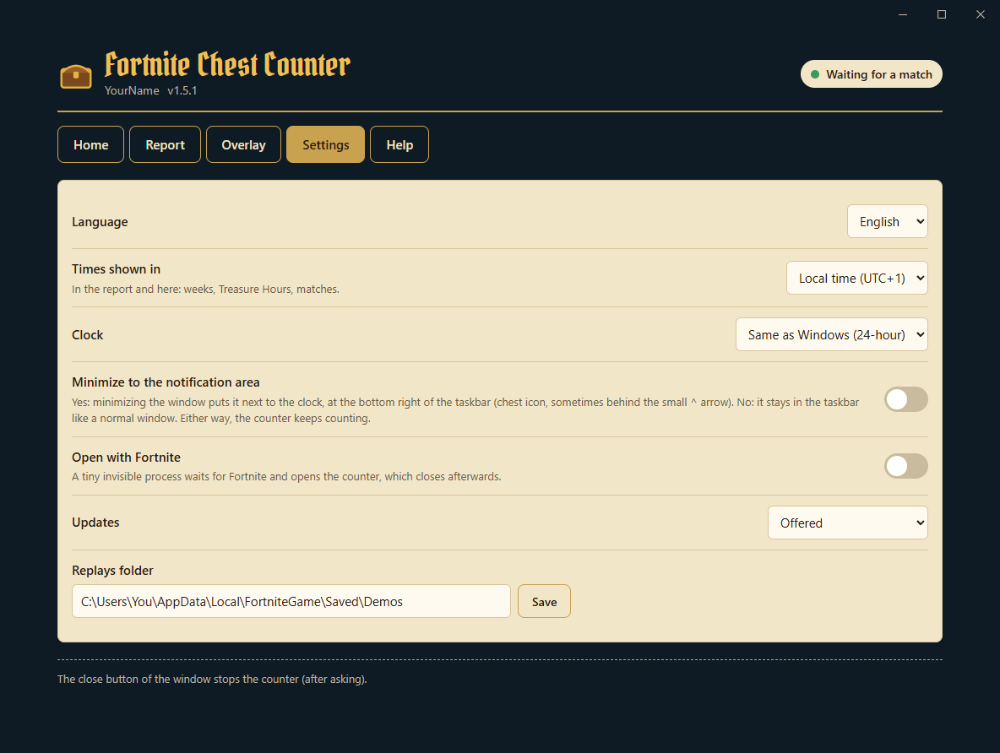
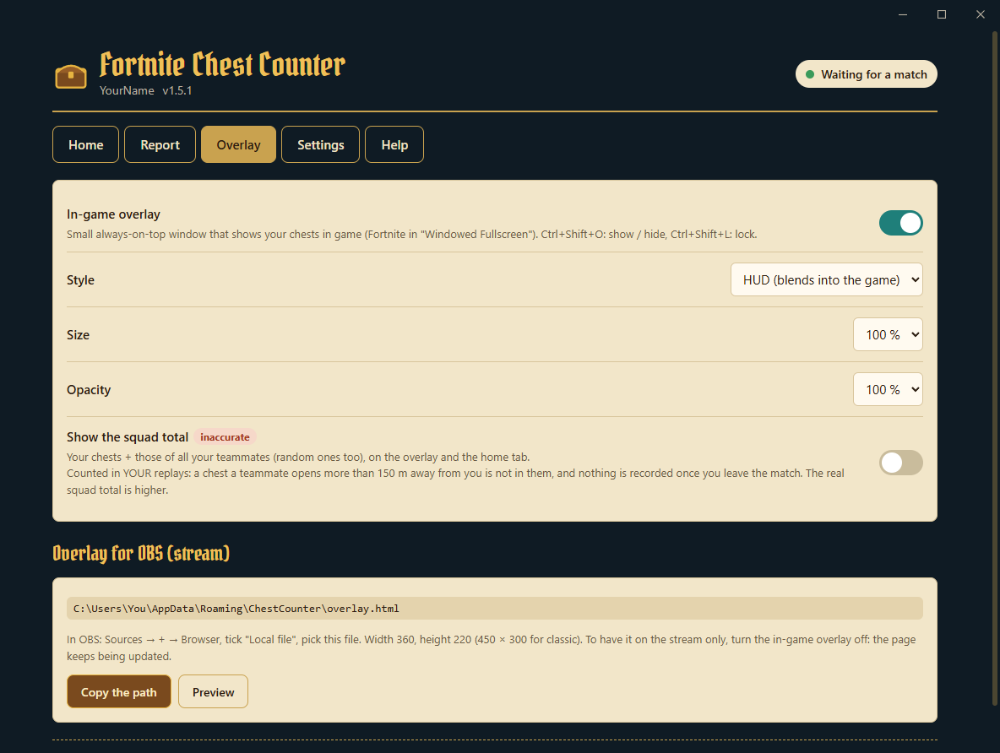
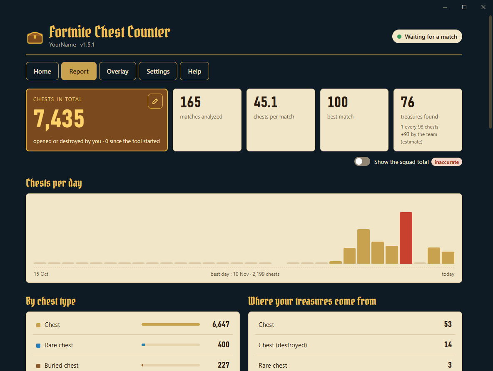

 <div align="center">

**English** · [Français](README.fr.md) · [Español](README.es.md)


# Fortnite Chest Counter

[](../../releases/latest)
[](../../releases)

[](LICENSE)

**Track every chest you open in Fortnite. Match after match.**

A lightweight chest tracker featuring a clean, customizable in-game overlay, detailed statistics, treasure tracking and much more.

> A fork of [LED-N/Fortnite-ChestCounter](https://github.com/LED-N/Fortnite-ChestCounter) (MIT). This version features a redesigned interface while retaining the original project's replay parsing and counting functionality.

 &nbsp;&nbsp; 

### [⬇ Download ChestCounter.exe](../../releases/latest)

Windows 10 / 11 · Free · Portable · No installation required

</div>

---

## Overview

Fortnite Chest Counter automatically analyzes the replay files generated by Fortnite after each match and keeps track of every chest you open.

But it goes beyond simple chest counting:

- **Live overlay:** Display your chest statistics directly over Fortnite.
- **Detailed statistics:** Track your total chests, matches, averages and personal records.
- **Treasure tracking:** Keep track of treasure hunt rewards and your collection.
- **Drop chances:** Calculate your chances of obtaining weekly rewards and other treasures.
- **Match history:** Review every analyzed match and its results.
- **Multiple profiles:** Automatically separate statistics from different Fortnite accounts.

Everything is stored locally on your computer, with no Epic Games login or account connection required.

> **Important:** Chest Counter tracks the chests you personally open. It does not reveal chest locations or display chests on the map.

## How it works

Chest Counter uses Fortnite's locally saved replay files to determine which chests you opened during a match.

Once a match ends, the application analyzes its replay and updates your statistics automatically.

### Privacy & Security

The application is designed to operate independently from the running Fortnite process.

- **Read-only replay access:** Only reads `.replay` files from `%LOCALAPPDATA%\FortniteGame\Saved\Demos\`.
- **No game modifications:** Does not modify Fortnite files or install anything into the game directory.
- **No memory access:** Never reads, writes or injects data into the Fortnite process.
- **No account access:** Does not require an Epic Games login or access to your account.
- **No telemetry:** No personal information or gameplay data is transmitted.
- **Local interface:** The application interface is served exclusively through `127.0.0.1` using a randomly generated key.
- **Minimal resource usage:** Runs at low priority, supports Windows 11 Efficiency Mode and reduces background activity when not needed.

The only external connections are to GitHub and are used to retrieve treasure hunt information, collection images and application updates.

> [!IMPORTANT]
> **Replay recording must be enabled in Fortnite.**
>
> Navigate to `Settings → Game → Replays → Record Replays` and set it to **On**.

Chest statistics are updated a few seconds after each match. Fortnite only provides the replay decryption key once the match has ended.

During a match, a small red indicator next to your overlay's total shows that a match is currently in progress.

## Getting Started

Getting started takes less than a minute.

1. Download the latest **[ChestCounter.exe](../../releases/latest)**.
2. Enable replay recording in Fortnite.
3. Launch `ChestCounter.exe`.
4. Complete the initial setup using the Welcome card.
5. Start playing! Your existing replays will automatically be analyzed.

<p align="center">
  
</p>

No complicated configuration is required. The Welcome card handles the essential settings, which can be changed later at any time.

> [!NOTE]
> Windows SmartScreen may display a warning because the executable is not digitally signed. If you trust the downloaded release, select **More info → Run anyway**.

### Automatic startup

Enable **Settings → Open with Fortnite** to automatically launch Chest Counter whenever Fortnite starts.

The application can then run minimized in the background without requiring manual interaction.

Keep in mind that Fortnite only retains a limited number of unsaved replays. Matches played while Chest Counter is closed may therefore be permanently missed.

---

## The Application

Chest Counter features five main sections, each designed to make your statistics easy to access.

- **Home:** Your overall statistics, current session, last match, treasures and recent activity.
- **Report:** Detailed statistics, drop probabilities, treasure history and match breakdowns.
- **Overlay:** Configure your in-game overlay and OBS browser source.
- **Settings:** Customize the application, language, startup behavior and replay directory.
- **Help:** Access documentation, application logs, troubleshooting information and uninstall options.

<p align="center">
  
</p>

### Editing your chest total

Already opened hundreds or thousands of chests before installing Chest Counter?

No problem. Use the pencil icon next to **Chests in total** to manually add your previous chest count.

You can also:

- Add or subtract chests from your total.
- Review every manual adjustment.
- Undo individual additions.
- Include previously opened chests in the current week's drop calculations.

If you don't know your exact number, Chest Counter can estimate it using your Fortnite career match count and your average chests per match.

<p align="center">
  
</p>

### Settings

<p align="center">
  
</p>

| Setting | Description |
|---|---|
| Language | Switch between English, French and Spanish. |
| Time zone | Display match times in local time or UTC. |
| Clock format | Use Windows defaults, 12-hour or 24-hour format. |
| Notification area | Minimize the application to the Windows system tray. |
| Open with Fortnite | Automatically launch alongside Fortnite. |
| Updates | Choose between manual, automatic or disabled updates. |
| Replay folder | Specify a custom replay directory. |
| Account profiles | Switch between automatically detected Fortnite accounts. |

## Open with Fortnite

The automatic startup feature allows Chest Counter to run alongside Fortnite without requiring you to launch it manually.

When enabled, a small background process starts with Windows and periodically checks whether Fortnite is running.

Here's what happens:

1. Windows starts the background process.
2. The process checks whether Fortnite is running.
3. When Fortnite launches, Chest Counter opens in a minimized state.
4. Once Fortnite closes, the application analyzes the final replay.
5. Chest Counter automatically closes after 30 seconds.

You can prevent automatic closing by enabling **Keep the counter open** on the Home tab.

The feature can be disabled at any time through Settings. Doing so also removes the background process from Windows startup.

> **Note:** While automatic startup is enabled, the background process continues running even after closing the main application. Disable the feature before moving or deleting `ChestCounter.exe`, or use **Help → Uninstall**.

---

## In-Game Overlay

The customizable overlay displays your statistics directly on top of Fortnite.

Designed to blend naturally into the game's HUD, it uses outlined text without a distracting background.

### Available statistics

- **Total:** Your lifetime chest count, including the golden chest indicator.
- **Last:** The number of chests opened in your previous match.
- **Session:** Your chest count since starting Chest Counter.
- **Treasures:** Your collected treasure count.

During an active match, a red indicator appears next to your total.

### Keyboard shortcuts

| Shortcut | Action |
|---|---|
| `Ctrl + Shift + O` | Show or hide the overlay. |
| `Ctrl + Shift + L` | Lock or unlock the overlay. |

When locked, mouse clicks pass through the overlay, making it suitable for use while playing.

When unlocked, you can move the overlay by holding the left mouse button. Right-clicking hides it.

### Customization

The Overlay tab allows you to customize:

- Overlay style: HUD or Classic.
- Size and opacity.
- Position on your screen.
- Visibility while playing.
- Squad statistics.

The Classic style uses a dark background and provides additional information.

<p align="center">
  
</p>

> [!TIP]
> For the overlay to appear over Fortnite, set **Window Mode → Windowed Fullscreen**. Exclusive Fullscreen prevents Windows from drawing external overlays over the game.

### Squad Statistics

Enable **Show the squad total** to display the combined chest count of your team.

This feature is disabled by default and should be considered an estimate. Chests opened by teammates more than 150 meters away may not appear in your replay data.

### OBS Streaming Support

Chest Counter also generates an `overlay.html` file in its data directory.

This file provides the same statistics as your in-game overlay, with a transparent background and automatic updates every five seconds.

To add it to OBS:

1. Open OBS.
2. Navigate to **Sources → + → Browser**.
3. Enable **Local file**.
4. Select `%APPDATA%\ChestCounter\overlay.html`.
5. Set the dimensions:
   - HUD: `360 × 220`
   - Classic: `450 × 300`

The Overlay tab includes a **Copy the path** option for quick access.

You can also disable the in-game overlay while keeping the OBS overlay active.

---

## Statistics & Reports

The Report tab automatically updates after every analyzed match.

It provides a detailed overview of your Fortnite chest activity.

<p align="center">
  
</p>

### Available statistics

- Total chests opened.
- Total matches analyzed.
- Average chests per match.
- Personal best match.
- Total treasures collected.
- Treasure frequency.
- Chests opened per day.
- Chest types and treasure sources.

### Drop Probabilities

The **Your chances** section calculates the probability of having received individual treasure hunt rewards at least once.

Each reward also receives a descriptive probability label, such as:

- Unlikely
- Possible
- Likely
- Almost certain

Weekly rewards, including the golden outfit, vehicles, pickaxes, back blings, jam tracks and loading screens, are calculated using the current week's chest count.

Other rewards, such as Pirate Shop Access and gizmos, use your entire treasure hunt history.

The displayed odds are based on the probabilities published by Epic Games.

### Treasure Hours

During a Treasure Hour, chest rewards receive boosted drop probabilities.

Chest Counter automatically detects the current or upcoming Treasure Hour and displays a countdown.

The affected reward probabilities are updated dynamically and highlighted in orange.

### Additional report sections

- **They got it in your matches:** Experimental tracking of Pirate Shop Access and golden outfits obtained by nearby players.
- **Your collection:** A weekly overview of this season's treasures, with checkboxes to track collected rewards.
- **Treasures found:** A complete history of detected treasures.
- **Latest matches:** Your most recent analyzed matches, displayed ten at a time.

The entire report is also exported to `report.html`, allowing you to view your statistics in any browser.

---

## Treasure Tracking

Chest Counter does more than count chests. It also tracks treasure hunt rewards and their origins.

### Golden Chests

When a chest grants a treasure hunt reward, Fortnite generates a golden chest containing the corresponding prize ID.

Chest Counter reads this information from the replay and identifies the associated reward.

### Individual Treasures

Every detected treasure is recorded with:

- The exact time it was obtained.
- The chest it originated from.
- The identified reward, when available.

Some treasure types cannot be identified because Fortnite does not include their exact type in the replay data. These are displayed as **Treasure (unknown type)**.

### Team Treasures

Treasure hunt rewards are shared across the entire team.

Chest Counter can estimate treasures obtained by teammates based on rewards received without opening a chest.

These are marked with a team icon and never added to your personal chest or treasure totals.

### Reliability Indicators

Rewards obtained through sources other than chests, such as ammo boxes, are marked with a ⚑ symbol.

These detections have low reliability and may result from replay parsing inaccuracies.

### Treasure Hunt Data

Fortnite only provides prize IDs, not the corresponding reward names.

The application retrieves reward names, weekly schedules, drop probabilities and Treasure Hour information from [`content/content.json`](content/content.json).

This information is downloaded directly from GitHub whenever Chest Counter starts, ensuring that new weekly rewards become available without requiring an application update.

---

## Multiple Fortnite Accounts

Chest Counter automatically detects which Fortnite account recorded each replay.

You don't need to enter your Epic Games username or configure individual profiles manually.

If replays from multiple accounts are detected on the same PC, each account receives its own profile with separate statistics and history.

You can switch between profiles using the account selector at the top of the application.

When you play on another account, Chest Counter automatically detects the change and assigns the match to the correct profile.

No matches are lost or mixed between accounts.

---

## Automatic Updates

Chest Counter checks GitHub for new releases whenever the application starts.

When an update is available, the Home tab displays the release notes in your selected language.

You can then install the update directly through the application.

Every update is downloaded, verified and installed automatically before Chest Counter restarts.

Your settings, profiles and complete match history are preserved.

### Update preferences

| Option | Description |
|---|---|
| Offered | Notifies you when a new version is available. |
| Automatic | Installs updates automatically between matches. |
| Off | Disables automatic update checks. |

You can also manually check for updates at any time using **Check for updates** on the Home tab.

---

## Your Data

All application data is stored locally in:

`%APPDATA%\ChestCounter`

You can open this directory through **Help → Open the data folder**.

| File / Folder | Description |
|---|---|
| `data.json` | Complete match history and statistics. |
| `config.json` | Application settings, profiles and overlay position. |
| `report.html` | Exported statistics report. |
| `overlay.html` | Transparent OBS overlay. |
| `matches.csv` | Match history in CSV format for Excel or Google Sheets. |
| `content.json` | Downloaded treasure hunt information. |
| `images/` | Downloaded treasure collection images. |
| `webview/` | Application interface data. |
| `errors.log` | Details about replay parsing errors. |

### Backing Up Your Data

To transfer your statistics to another PC, simply back up `data.json` and restore it in the new installation.

To completely reset Chest Counter, delete the application data directory.

If you previously used ChestTracker, your existing `%APPDATA%\ChestTracker` directory will be migrated automatically.

---

## Frequently Asked Questions

<details>
<summary><strong>Nothing is being counted. What should I do?</strong></summary>

Make sure replay recording is enabled in Fortnite and that Chest Counter is running when your match ends.

The application displays the current replay directory status at the top of the window.

The Home tab also provides activity logs explaining why individual matches may have been skipped.
</details>

<details>
<summary><strong>Are ammo boxes counted?</strong></summary>

No. Ammo boxes, food containers and loot cannons are excluded from the chest total.

Chests destroyed instead of opened are still counted.

A chest that gets refilled and opened again during the same match counts again. However, revisiting an already opened chest does not count it twice.
</details>

<details>
<summary><strong>Which Fortnite game modes are supported?</strong></summary>

Chest Counter currently supports Battle Royale on the current season's map:

- Build and Zero Build.
- Solo, Duos, Trios and Squads.

The following modes are not supported:

- Ranked.
- OG.
- Reload.
- Blitz.
- Other limited-time modes.
- Creative and UEFN islands.
- LEGO.
- Festival.
- Private matches.

The application automatically checks the map and game mode using replay data. Skipped matches include an explanation in the activity log.
</details>

<details>
<summary><strong>Why does a match display a warning symbol (⚠)?</strong></summary>

In some situations, Fortnite does not record which objects were destroyed by your vehicle.

This can make chest loot appear in the replay without the corresponding chest being recorded.

The warning symbol indicates that the match contains incomplete chest information.
</details>

<details>
<summary><strong>What happens if Fortnite crashes during a match?</strong></summary>

If Fortnite closes before generating the replay decryption key, the replay remains incomplete.

Chest Counter cannot analyze that match and marks it as an incomplete replay.
</details>

<details>
<summary><strong>Why can't I read a replay after a Fortnite update?</strong></summary>

Fortnite updates can change the replay file format.

When this happens, the replay parser may need to be updated before new matches can be analyzed.

Previously counted matches remain unaffected.

If the problem persists, [open an issue](../../issues) and attach your `errors.log` file using **Help → Open the error log**.
</details>

<details>
<summary><strong>Why can't I delete ChestCounter.exe?</strong></summary>

If **Open with Fortnite** is enabled, the background process may continue using the executable even after the main application has closed.

You have two options:

1. Use **Help → Uninstall ChestCounter** to disable automatic startup, close the application and remove the executable.
2. Disable **Settings → Open with Fortnite**, close Chest Counter and delete the executable manually.

During uninstallation, you can choose whether to preserve or delete your history and settings.
</details>

<details>
<summary><strong>Where did my application window go?</strong></summary>

If **Minimize to the notification area** is enabled, the application moves to the Windows system tray next to the clock.

Look for the Chest Counter icon, which may be hidden behind the small arrow in the taskbar.

Clicking the icon restores the window. Launching `ChestCounter.exe` again also brings the existing window to the foreground.
</details>

<details>
<summary><strong>The application window is blank or opens in my browser.</strong></summary>

Chest Counter uses Microsoft Edge WebView2 to display its interface.

WebView2 is included with Windows 11 and installed on most Windows 10 systems.

If it is missing, install the [Microsoft Edge WebView2 Runtime](https://developer.microsoft.com/microsoft-edge/webview2/) using the Evergreen Bootstrapper.
</details>

<details>
<summary><strong>Can multiple instances of Chest Counter run simultaneously?</strong></summary>

No. Only one instance can run at a time.

Launching the executable again will simply bring the already running application window to the foreground.
</details>

<details>
<summary><strong>Can the same match be counted twice?</strong></summary>

No. Chest Counter recognizes previously analyzed replays, even if you rename or manually save them.
</details>

---

## Command Line Arguments

Chest Counter supports several command-line options for advanced users and automation.

```bash
ChestCounter.exe --lang <fr|en|es>       Change the application language
ChestCounter.exe --demos <folder>       Specify a custom replay directory
ChestCounter.exe --data <folder>        Specify a custom data directory
ChestCounter.exe --once                 Analyze finished replays and exit
ChestCounter.exe --reset-config         Reset settings without deleting history
ChestCounter.exe --overlay-preview <file.png>
                                          Export overlay previews and exit
```

---

## Build From Source

Want to compile Chest Counter yourself?

You only need the **.NET 10 SDK** for Windows x64.

1. Download and install the [.NET 10 SDK](https://dotnet.microsoft.com/download/dotnet/10.0).
2. Clone or download this repository.
3. Run `build.bat`.
4. Find the compiled executable in `dist\ChestCounter.exe`.

GitHub Actions automatically builds the application on every push.

When a version tag starting with `v` is pushed, the workflow also creates a GitHub release and attaches the compiled executable.

Release notes are taken from [`RELEASE_NOTES.md`](RELEASE_NOTES.md) and displayed inside the application after updates.

---

## License & Credits

Chest Counter is released under the **[MIT License](LICENSE)**.

This project builds upon several open-source projects and external resources:

- **[LED-N/Fortnite-ChestCounter](https://github.com/LED-N/Fortnite-ChestCounter):** Original chest counting and replay analysis implementation.
- **[FortniteReplayDecompressor](https://github.com/Shiqan/FortniteReplayDecompressor):** Replay parsing library by Shiqan (MIT), with modifications documented in [`lib/PATCHES.md`](lib/PATCHES.md).
- **[Microsoft Edge WebView2](https://developer.microsoft.com/microsoft-edge/webview2/):** Application interface rendering.
- **[Pirata One](https://fonts.google.com/specimen/Pirata+One):** Font used for headings (SIL Open Font License).
- **[fortnite.bot](https://fortnite.bot):** Treasure hunt information and collection images.
- **[koiseka](https://github.com/koiseka):** Contributions and counting fixes in [PR #6](../../pull/6).

---

<div align="center">

**Fortnite Chest Counter**

*Every chest counts.*

[Download the latest version](../../releases/latest) · [Report a bug](../../issues) · [View source code](../../)

</div>

> This project is not affiliated with, endorsed by or sponsored by Epic Games. Fortnite is a trademark of Epic Games, Inc.
